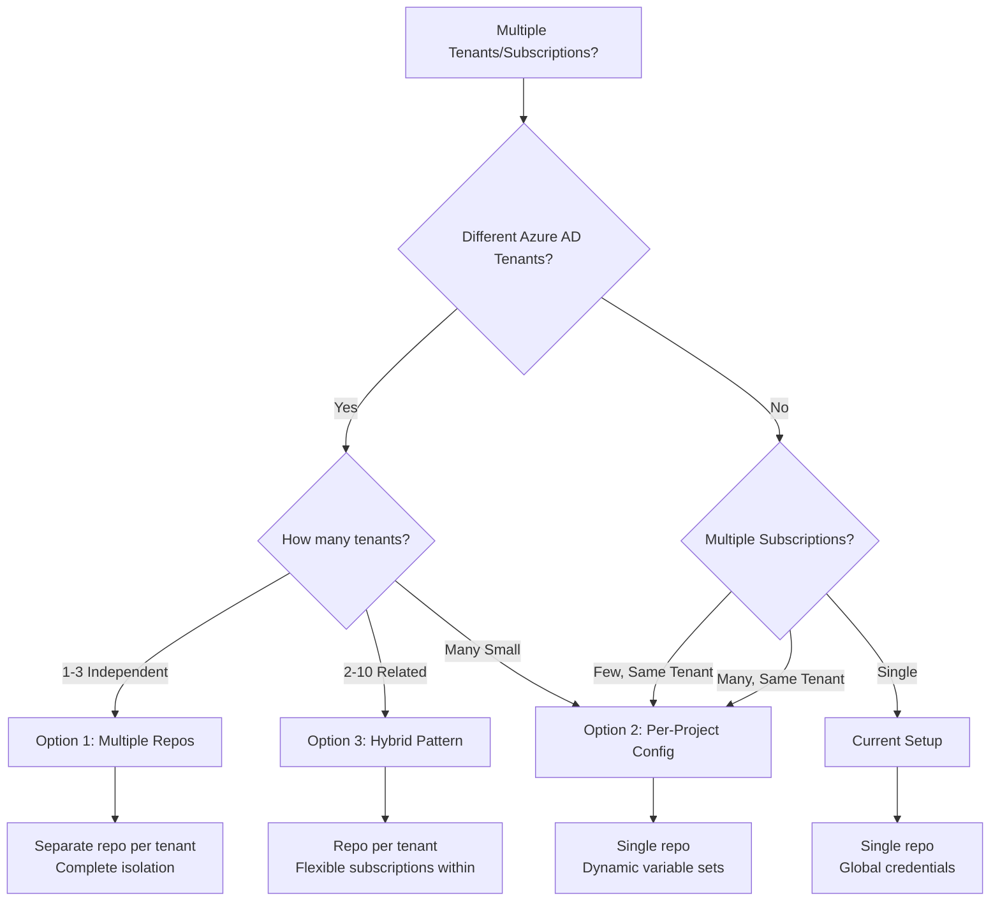
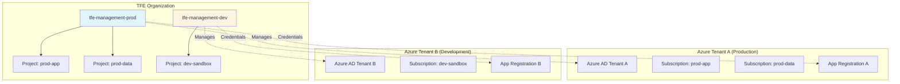
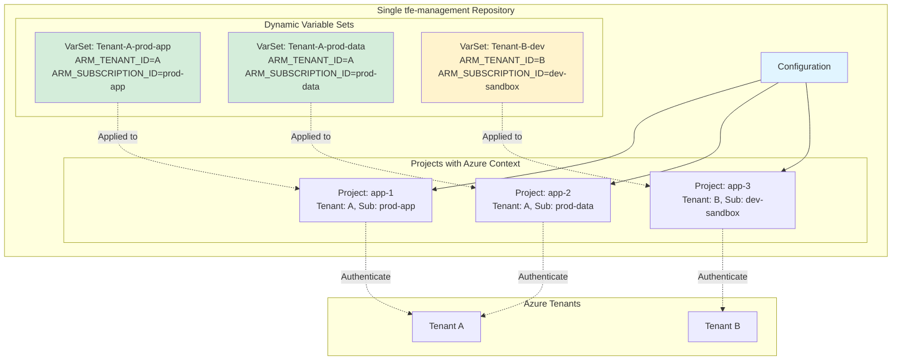
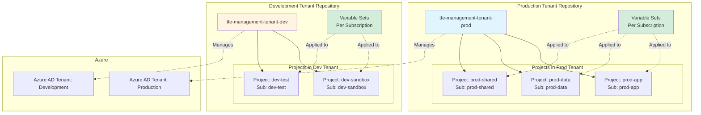
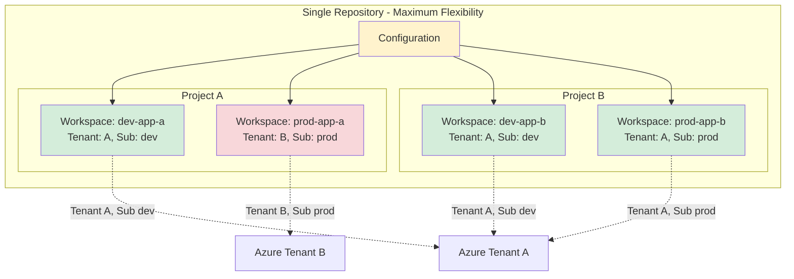
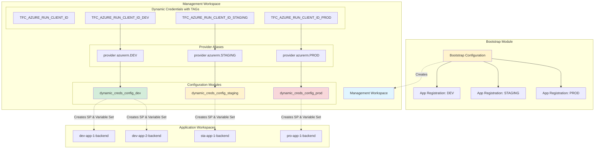
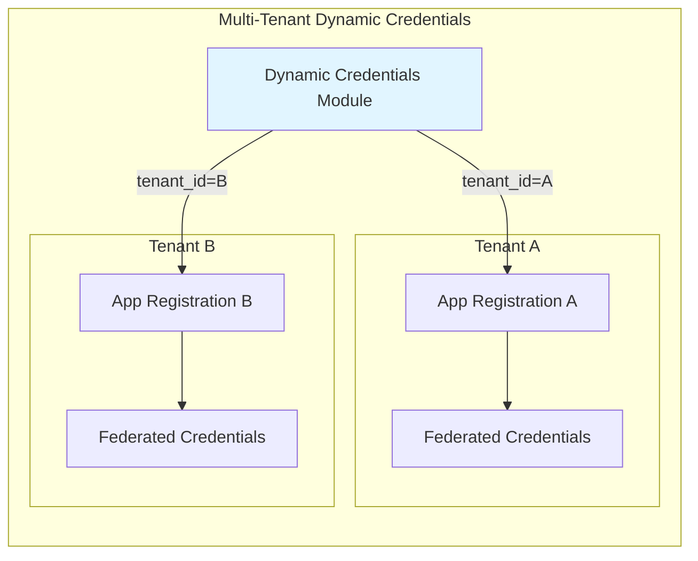
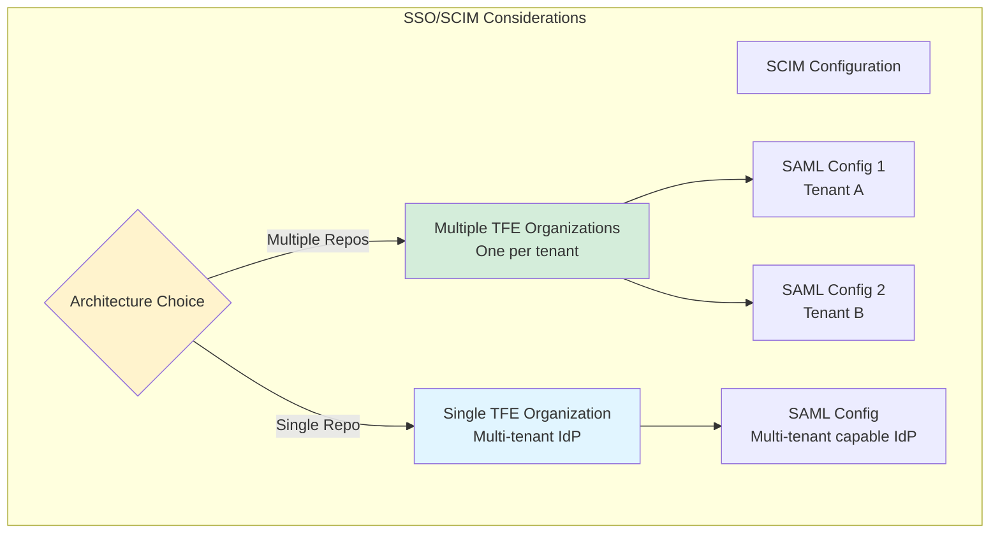
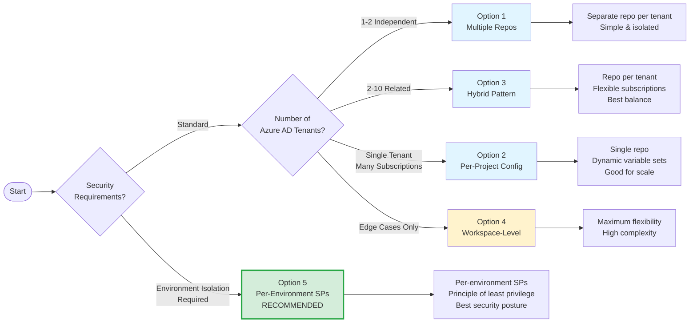

# TFE Management

> **Disclaimer:** this is a personal project and not an official HashiCorp product. It is not officially supported or maintained by HashiCorp, and I share it to help out the community. It comes "as is", without any warranty. There may be errors, and the Terraform, provider or module versions used here may get deprecated or stop working. Please review and test everything outside production before using it, and use it at your own risk. The repository is public and issues and pull requests are welcome, but I review and validate each one myself, so there is no guaranteed response time, no promise to merge, and no support SLA (see [CONTRIBUTING](.github/CONTRIBUTING.md)). All names, IDs and values are examples or placeholders, so never commit credentials. Terraform, HCP Terraform and Terraform Enterprise are trademarks of HashiCorp.

> **Looking for a different setup?** This branch (`multi-provider-azure-dynamic-credentials`) uses Azure dynamic credentials (OIDC) with several subscriptions of the same tenant, one aliased provider and App Registration each, and the VCS-driven workflow. Check out the other branches for other configurations: `main` for the single-subscription baseline, and `single-provider-azure-static-credentials` for a static Service Principal secret, a CLI-driven workflow and local policy sets.

This Terraform configuration serves as the **management layer** for the Terraform Enterprise (TFE) organization, enabling complete GitOps-based control of TFE infrastructure. All TFE configuration changes are managed through Infrastructure as Code (IaC), eliminating manual "clickops" in favor of version-controlled, auditable changes.

## Overview

This management module controls all aspects of the TFE organization using the TFE provider, including:

- **Projects and Workspaces**: Organizational structure and execution environments
- **Teams and Permissions**: Access control and team management
- **SSO/SCIM Integration**: Enterprise authentication and user provisioning
- **Variable Sets**: Shared configuration across workspaces
- **Policy Sets**: Sentinel and OPA policy enforcement, from VCS repositories or from local files (Terraform policies may be added later)
- **VCS Integration**: Version control system connections
- **Dynamic Credentials**: Azure workload identity federation for secure, keyless authentication

### Authentication Method

This branch uses **Azure dynamic credentials (OIDC / workload identity federation) with multiple providers**: one aliased `azurerm` provider and one App Registration / Service Principal **per subscription** (`subscription-a` and `subscription-b` in the code), created by the `multi-provider-azure-dynamic-credentials` branch of `tfe-bootstrap`. No Azure secret is stored in TFE.

- Each workspace declares in `dynamic_credentials` which subscription it uses and for which run phases. Only those workspaces receive the matching variable set and federated credential.
- All subscriptions must belong to the **same Azure tenant** (`az_tenant_id`). Multi-tenant is not supported by this branch.
- To add a subscription, add its variables, provider alias, variable set and `dynamic-credentials-azure-management` call following the existing ones.

> Authentication currently focuses on **Azure**. Other clouds will come.

## Dependencies and Related Repositories

| Repository | Role |
|------------|------|
| [`tfe-tf-modules`](https://github.com/permilche/tfe-tf-modules) | **Source of the modules** this repository calls (`saml-sso-and-scim`, `project`, `workspace`, `variable-set`, `policy-set`, ...). It is not referenced directly: its modules are published to the private registry by `tfe-private-registry` and consumed from there |
| [`tfe-bootstrap`](https://github.com/permilche/tfe-bootstrap) | **Creates the workspace that runs this repository** (branch `multi-provider-azure-dynamic-credentials`), its SSH key and the variables it needs (`tfc_application_*_subscription_<x>`, `az_subscription_id_subscription_<x>`, `az_tenant_id` (the `subscription-a` / `subscription-b` names are in `variables.tf`, `providers.tf` and `main.tf`), `organization`, `tfe_token`, `tfe_hostname`, `vcs_oauth_token_id`, ...) |
| [`tfe-private-registry`](https://github.com/permilche/tfe-private-registry) | **Must be applied first.** It registers the `tfe-tf-modules` modules, and creates their versions through tags, in the private registry that this repository consumes |

## Before You Start: Values to Replace

1. **Registry module sources.** Every module `source` in [`main.tf`](main.tf) is `app.terraform.io/<organization_name>/<module>/tfe`. Replace `<organization_name>` with your organization, and `app.terraform.io` (HCP Terraform) with your own FQDN if you run **self-hosted TFE**. A `source` cannot use variables, so this must be hardcoded. Each line has a comment saying so.
2. **`tfe_hostname`.** Injected by `tfe-bootstrap`: `app.terraform.io` for HCP Terraform, or your FQDN for self-hosted TFE (it must match the FQDN used in the sources).
3. **Module versions.** Most `version` arguments are commented out (latest version is used) and one is set. Set each `version` to one that `tfe-private-registry` has published (tag `<module>-<version>`), or leave them out.
4. **SAML / SCIM.** In `main.tf`, replace `<tenant_id>` in `sso_endpoint_url` and `slo_endpoint_url` with your Microsoft Entra tenant ID. The SAML module also needs the **IdP signing certificate** of your Entra ID enterprise application (`idp_cert`, read from `idp_cert_path`): TFE uses it to verify the signature of the SAML assertions. It is a public certificate and **normally should be committed** to the repository the workspace runs from. Only the author's file name, `certs/azure-ad-certificate.cer`, is git-ignored here, so that a certificate from another environment is not published and others can reuse the repository: save yours under a different name and set `idp_cert_path` (it will then be tracked), or delete that line from `.gitignore` (see [Setup Instructions](#setup-instructions)). The break-glass admin settings of the SAML module are not used by this configuration (they only produce instructions in a module output), so they were removed.
5. **VCS (Azure DevOps).** `vcs_org`, `vcs_project` and the example projects, workspaces and policy sets (`variables.tf` defaults) refer to Azure DevOps repositories that do not exist in your environment. Adapt them.
6. **Azure values.** `tfc_application_*_subscription_<x>`, `az_subscription_id_subscription_<x>`, `az_tenant_id` (the `subscription-a` / `subscription-b` names are in `variables.tf`, `providers.tf` and `main.tf`) are provided by `tfe-bootstrap` as workspace variables. Do not commit them. `terraform.tfvars` is git-ignored (`*tfvars`) and only `terraform.tfvars.example` is tracked.
7. **SCIM: two-step apply.** The SCIM team mappings need the IdP to synchronize first, so a new organization needs a **two-step apply** (details in [Configure SCIM in Azure AD](#1-configure-scim-in-azure-ad)): (1) apply with SCIM enabled and without the team mappings, (2) configure provisioning in Entra ID with the SCIM token and wait for the sync, (3) uncomment and apply again. The lines to toggle are marked `IMPORTANT: uncomment after applying first` in `main.tf`: `scim_teams`, `project_team_access`, `workspace_team_access` and the `team_access` arguments of the projects and workspaces modules. **This branch is currently in the first-apply state** (those lines are commented out).

### Important Context

This is **not** the initial bootstrap configuration. A separate bootstrap configuration creates this management workspace in TFE. Once established, this management layer becomes the single source of truth for all TFE configuration changes, ensuring:

- **GitOps Workflow**: All changes go through version control and code review
- **Auditability**: Complete history of infrastructure changes
- **Consistency**: Declarative configuration prevents configuration drift
- **No Clickops**: Manual UI changes are avoided in favor of IaC

### Organization Setup
- **Organization**: Pre-existing, managed by separate bootstrap
- **SSO/SCIM**: EntraID (Azure AD) integration with automatic user provisioning
- **Dynamic Credentials**: Azure workload identity federation configured for secure, keyless authentication to Azure
- **Private Registry**: Uses SSH key authentication to connect to the source repository and publish modules to TFE's private registry. This is necessary because the VCS OAuth connection cannot be used for the initial registry module publication, it creates a chicken-and-egg problem where the registry module would need to exist before it can be used to create itself. Once the modules are published to the private registry, other configurations can reference them using the standard registry syntax. This SSH Key is added to the management workspace (where this configuration runs) from the bootstrap module that creates this workspace and its SSH Key.

### Projects (Default Configuration)

The following projects are created by default via `var.projects` (these are **default values** and can be customized based on your requirements):

1. `app-1`: App 1 Project
   - **Hashicorp team**: Admin access
   - **Developers team**: Custom access with read permissions on project settings and full workspace management capabilities
2. `app-2`: App 2 Project
   - **Hashicorp team**: Admin access
   - **Developers team**: Admin access

**Team Access Management at Project Level:**

Projects support team access configuration that controls permissions across all workspaces within the project. The implementation uses a `project_team_access` local variable that merges team configurations from projects with actual team IDs, mapping project permissions accordingly. This approach handles the complexity of both `team_id` and `project_id` resolution internally using a `for_each` loop, maintaining a clean, declarative interface.

**You only need to specify the team name** (e.g., "Hashicorp", "Developers") and desired permissions, the module automatically:
- Resolves team names to team IDs
- Injects the project ID when creating team project access resources
- Handles the mapping between projects and their team access configurations

**Access Levels:**
- **Admin**: Full administrative access (simplified configuration)
- **Custom**: Granular control via `project_access` and `workspace_access` objects

**Example Configuration:**
```hcl
"app-1" = {
  description = "App 1 Project"
  team_access = {
    "Hashicorp" = {
      access = "admin"  # Simple admin access
    }
    "Developers" = {
      # Custom granular permissions
      project_access = {
        settings      = "read"   # read, update, or delete
        teams         = "read"
        variable_sets = "read"
      }
      workspace_access = {
        create           = true
        locking          = true
        delete           = true
        move             = true
        policy_overrides = false
        runs             = "apply"  # read, plan, or apply
        run_tasks        = true
        sentinel_mocks   = "read"   # none or read
        state_versions   = "write"  # none, read-outputs, read, or write
        variables        = "write"  # none, read, or write
      }
    }
  }
}
```

For detailed permission options, refer to the [TFE Project Permissions Documentation](https://developer.hashicorp.com/terraform/enterprise/users-teams-organizations/permissions/project).

**Note**: You can modify the `projects` variable in `variables.tf` or your `terraform.tfvars` file to create different projects based on your organizational needs.

### Workspaces (Default Configuration)

The following workspaces are created by default via `var.workspaces` with VCS workflow (these are **default values** and can be customized):

1. `dev-app-1-backend`: Development backend workspace for app-1 (dynamic credentials enabled for `subscription-a` on plan and apply)
2. `dev-app-2-backend`: Development backend workspace for app-2 (dynamic credentials enabled for `subscription-b` on plan and apply)

**Permission Design Rationale:**

The default configuration demonstrates two permission models:

**app-1 (Balanced Security Model):**
- **Hashicorp team**: Full admin access for platform management
- **Developers team**: Custom granular permissions designed to provide:
  - **Project-level read-only access**: Developers can view organizational structure (settings, teams, variable sets) but cannot modify it, maintaining security boundaries while providing visibility
  - **Full workspace operational capabilities**: Complete autonomy for workspace lifecycle (create, lock, delete, move) and deployment operations (plan + apply)
  - **Security controls**: `policy_overrides = false` prevents bypassing Sentinel policies. `sentinel_mocks = "read"` allows viewing but not modifying policy test data
  - **Operational permissions**: Full state and variable management (`write` access) necessary for normal Terraform operations

This model is ideal for development teams that need operational autonomy within their workspaces while restricting project-level changes that could affect the entire organization.

**app-2 (Simplified Admin Model):**
- **Hashicorp team**: Full admin access
- **Developers team**: Simple admin access for complete control

This model is appropriate for less critical projects, smaller teams, or when developers need full administrative capabilities without granular restrictions.

**Variable Management Strategy:**

The app-1 configuration demonstrates a powerful security pattern:
- **Variable Sets (Project-level)**: Read-only access (`variable_sets = "read"`) prevents developers from modifying shared organizational configuration
- **Workspace Variables**: Full write access (`variables = "write"`) allows developers to manage workspace-specific configuration

This creates an excellent balance:
- **Operability**: Developers can freely manage workspace-specific variables for their applications
- **Security**: Shared variable sets (e.g., Azure credentials, compliance settings) remain protected from accidental or unauthorized changes
- **Flexibility**: If a workspace needs different values from a shared variable set, developers can override them at the workspace level

**Practical Use Cases:**

1. **Requesting New Variable Sets**: When multiple workspaces need shared configuration (e.g., database connection strings, API endpoints), developers can:
   - Request the platform team to create a new variable set
   - Or, if permissions allow, create workspace-specific variables as a temporary solution
   - Platform team can later consolidate common patterns into shared variable sets

2. **Environment-Specific Permissions**: Consider different permission models per environment:
   ```hcl
   # Development: Full autonomy
   "dev-project" = {
     team_access = {
       "Developers" = { access = "admin" }
     }
   }
   
   # Production: Restricted access
   "prod-project" = {
     team_access = {
       "Developers" = {
         workspace_access = {
           runs = "plan"  # Can plan but not apply
           variables = "read"  # Read-only variables
           # ... other restrictions
         }
       }
     }
   }
   ```

3. **Graduated Permissions**: Start restrictive and gradually expand:
   - New teams: Read-only or plan-only access
   - Established teams: Full workspace management
   - Senior teams: Project-level permissions for self-service

4. **Audit and Compliance**: Use read-only project access to ensure:
   - Developers can view team assignments for collaboration
   - Settings remain visible for troubleshooting
   - Changes to organizational structure go through proper approval channels

**Customization Guidance:**
These are **reference examples**, adjust based on your organization's:
- Security requirements and compliance needs
- Team structure and trust levels
- Environment criticality (dev/staging/prod may need different permissions)
- Operational workflows and deployment practices
- Regulatory requirements (SOC2, HIPAA, PCI-DSS, etc.)

3. `sta-app-1-backend`: Staging backend workspace for app-1 (Developers team: `write` access)
4. `pro-app-1-backend`: Production backend workspace for app-1 (Developers team: custom read-only permissions)
5. `dev-app-1-frontend`: Development frontend workspace for app-1 (includes `EXAMPLE_VAR` local variable)
6. `sta-app-1-frontend`: Staging frontend workspace for app-1
7. `pro-app-1-frontend`: Production frontend workspace for app-1

**Workspace Configuration:**
- All workspaces follow VCS workflow connected to Azure DevOps
- Repository mapping:
  - Backend workspaces → `{project_key}-backend` repository
  - Frontend workspaces → `{project_key}-frontend` repository
- Branch mapping by environment:
  - `dev-*` workspaces → `develop` branch
  - `sta-*` workspaces → `staging` branch
  - `pro-*` workspaces → `main` branch
- **Local Variables**: Workspaces can define local variables (Terraform or environment variables)
- **Dynamic Credentials**: Workspaces can enable Azure dynamic credentials per subscription and per run phase via the `dynamic_credentials` map

**Team Access Management:**
The workspace module includes team access configuration at the workspace level. This design choice provides several benefits:
- **Intuitive Management**: Define team permissions when creating the workspace, rather than managing them separately in team modules
- **Single Apply**: Avoid the two-step process of creating workspaces first, then updating team modules with workspace IDs
- **DRY Principle**: Works with both SCIM teams and regular teams without duplicating logic across modules

The implementation uses a `workspace_team_access` local variable that merges team configurations from workspaces with actual team IDs, mapping workspace permissions accordingly. This approach handles the complexity of team ID resolution internally while maintaining a clean, declarative interface.

**Note**: You can modify the `workspaces` variable in `variables.tf` or your `terraform.tfvars` file to create different workspaces, connect to different repositories, or use different branch strategies.

### Variable Sets

Two per-subscription variable sets are created, each assigned only to workspaces that have opted in via `dynamic_credentials`:

1. **Dynamic Azure Credentials Variable Set, subscription-a**: Contains environment variables for Azure workload identity federation against the `subscription-a` subscription:
   - `TFC_AZURE_PROVIDER_AUTH`: Enables dynamic credentials
   - `TFC_AZURE_RUN_CLIENT_ID`: Azure application client ID for `subscription-a`
   - `ARM_SUBSCRIPTION_ID`: Azure subscription ID for `subscription-a`
   - `ARM_TENANT_ID`: Azure tenant ID

2. **Dynamic Azure Credentials Variable Set, subscription-b**: Contains environment variables for Azure workload identity federation against the `subscription-b` subscription:
   - `TFC_AZURE_PROVIDER_AUTH`: Enables dynamic credentials
   - `TFC_AZURE_RUN_CLIENT_ID`: Azure application client ID for `subscription-b`
   - `ARM_SUBSCRIPTION_ID`: Azure subscription ID for `subscription-b`
   - `ARM_TENANT_ID`: Azure tenant ID

Both variable sets are scoped per-workspace (never per-project) to prevent credential bleed, only workspaces that declare the subscription in their `dynamic_credentials` map receive the corresponding variable set.

### Policy Sets (Default Configuration)

The following policy sets are created by default via `var.policy_sets` with VCS workflow (these are **default values** and can be customized):

1. `policy-library-azure-compute-terraform`: Azure Compute Terraform Policy Library
   - **Assignment**: Global (applied to all workspaces)
   - **Excluded Projects**: `tfe-management` (excluded to avoid applying compute policies to the management project)
   - **Repository**: `policy-library-azure-compute-terraform`
   - **Branch**: `main`
   - **Kind**: Sentinel (default)

2. `policy-library-azure-networking-terraform`: Azure Networking Terraform Policy Library
   - **Assignment**: Specific workspace (`dev-app-1-backend`)
   - **Repository**: `policy-library-azure-networking-terraform`
   - **Branch**: `main`

3. `policy-library-azure-storage-terraform`: Azure Storage Terraform Policy Library
   - **Assignment**: Specific project (`app-2`)
   - **Repository**: `policy-library-azure-storage-terraform`
   - **Branch**: `main`

**Policy Set Configuration:**
- All policy sets follow VCS workflow connected to Azure DevOps
- Repository naming: `policy-library-{domain}-{technology}-terraform`
- Default branch: `main`
- Default kind: `sentinel` (Sentinel policies)

**Assignment Strategies:**

Policy sets can be assigned in three ways:

1. **Global Assignment** (`global = true`): Applied to all workspaces in the organization
   - Use for organization-wide compliance policies
   - Allows excluding projects (`exclude_projects`) and workspaces (`exclude_workspaces`)
   - Example: Security baselines, cost controls, naming conventions

2. **Project-Level Assignment** (`assign_to_projects`): Applied to all workspaces within specified projects
   - Use for project-specific governance
   - Example: Environment-specific policies, team-specific requirements

3. **Workspace-Level Assignment** (`assign_to_workspaces`): Applied to specific workspaces
   - Use for fine-grained control
   - Example: Production-only policies, application-specific rules

**Example Configuration:**
```hcl
"policy-library-azure-compute-terraform" = {
  repository       = "policy-library-azure-compute-terraform"
  description      = "Azure Compute Terraform Policy Library"
  global           = true  # Applied to all workspaces
  exclude_projects = ["tfe-management"]  # Exclude the management project
}

"policy-library-azure-networking-terraform" = {
  repository           = "policy-library-azure-networking-terraform"
  description          = "Azure Networking Terraform Policy Library"
  assign_to_workspaces = ["dev-app-1-backend"]  # Specific workspaces
}

"policy-library-azure-storage-terraform" = {
  repository           = "policy-library-azure-storage-terraform"
  description          = "Azure Storage Terraform Policy Library"
  assign_to_projects   = ["app-2"]  # All workspaces in app-2 project
}
```

**Policy Set Management:**
- Policy sets are version-controlled in separate repositories
- Changes to policies are managed through Git commits
- TFE automatically syncs policy updates from VCS
- Policies are evaluated during plan and apply phases

**Customization Guidance:**
You can modify the `policy_sets` variable in `variables.tf` or your `terraform.tfvars` file to:
- Add new policy sets for different Azure services or compliance frameworks
- Change assignment strategies (global vs. project vs. workspace)
- Connect to different policy repositories
- Use different policy kinds (sentinel, opa)

**Note**: VCS-based policy sets require corresponding repositories in your VCS provider (Azure DevOps in the examples) with valid Sentinel or OPA policy code. Terraform policies (an alternative to Sentinel and OPA) were not available when this was built, but they are expected to be, and this configuration can then be expanded to support them too, not only `sentinel` or `opa`. Policies can also be local: put the files in the `policies` folder and no VCS integration is needed (a CLI-driven workflow works too), even though VCS is simpler to maintain. See the `single-provider-azure-static-credentials` branch for an example.

### Dynamic Credentials Management

- **Azure Workload Identity Federation**: Automatically configures federated identity credentials in Azure AD for each workspace that has opted into a subscription via `dynamic_credentials`
- **Per-Workspace, Per-Subscription Control**: Each workspace explicitly declares which subscription it authenticates against and for which run phases
- **Secure Authentication**: No static credentials stored in TFE, uses OIDC tokens for authentication
- **Managed by `tfe-bootstrap`**: the Azure IDs this workspace receives (application IDs, subscription and tenant) are injected by the bootstrap layer. Change them there and not in the TFE UI or the Portal, otherwise the next bootstrap apply reverts them (drift). If you manage them somewhere else on purpose, add a `lifecycle { ignore_changes = [value] }` block to those variables in the `tfe-bootstrap` project
- **Zero credential bleed**: Variable sets are assigned only to the workspaces that opted in, never to entire projects

#### Required Terraform Variable

TFE automatically injects a `tfc_azure_dynamic_credentials` variable at runtime containing the OIDC token and client ID file paths needed by each provider. **This variable must exist in `variables.tf` with the exact name and type shown, do not rename or modify it.**

> 📖 Official docs: [Azure Dynamic Provider Credentials, Required Terraform Variable](https://developer.hashicorp.com/terraform/enterprise/dynamic-provider-credentials/azure-configuration#required-terraform-variable)

```hcl
variable "tfc_azure_dynamic_credentials" {
  description = "Object containing Azure dynamic credentials configuration supplied by TFE at runtime"
  type = object({
    default = optional(object({
      client_id_file_path  = string
      oidc_token_file_path = string
    }))
    aliases = map(object({
      client_id_file_path  = string
      oidc_token_file_path = string
    }))
  })
}
```

#### Provider Alias Naming Standard

A consistent naming standard is used to derive provider aliases from subscription names:
- **Subscription name**: Lowercase with hyphens (e.g., `subscription-a`, `subscription-b`)
- **Provider alias**: Uppercase with hyphens replaced by underscores (e.g., `SUBSCRIPTION_A`, `SUBSCRIPTION_B`), derived via `upper(replace(sub, "-", "_"))`

The alias must match the TAG of the `TFC_AZURE_*` variables exactly, including the case (`SUBSCRIPTION_A` works, `subscription_a` does not). This ensures a predictable 1:1 mapping between workspace `dynamic_credentials` subscription keys and the corresponding provider aliases and dynamic credential tags.

The `default` field is marked `optional` because this workspace uses only aliased providers (`SUBSCRIPTION_A`, `SUBSCRIPTION_B`), TFE populates `aliases` only. Each provider block reads from the corresponding alias:

```hcl
provider "azurerm" {
  alias                = "SUBSCRIPTION_A"
  use_cli              = false  # avoids misleading error messages on auth failure
  use_oidc             = true   # required when using multiple provider configurations
  client_id_file_path  = var.tfc_azure_dynamic_credentials.aliases["SUBSCRIPTION_A"].client_id_file_path
  oidc_token_file_path = var.tfc_azure_dynamic_credentials.aliases["SUBSCRIPTION_A"].oidc_token_file_path
  subscription_id      = var.az_subscription_id_subscription_a
  tenant_id            = var.az_tenant_id
  features {}
}
```

The `azuread` provider is tenant-scoped (not subscription-scoped) and uses the `SUBSCRIPTION_A` alias since both subscriptions share the same tenant.

#### Workspace configuration

```hcl
# A workspace using subscription-a for both plan and apply
"dev-app-1-backend" = {
  project_key = "app-1"
  environment = "dev"
  app_type    = "backend"
  dynamic_credentials = {
    "subscription-a" = ["plan", "apply"]
  }
}

# A workspace using subscription-b for plan only (e.g. read-only prod validation)
"pro-app-1-backend" = {
  project_key = "app-1"
  environment = "pro"
  app_type    = "backend"
  dynamic_credentials = {
    "subscription-b" = ["plan"]
  }
}

# A workspace with no dynamic credentials (omit the field or leave as {})
"sta-app-1-frontend" = {
  project_key = "app-1"
  environment = "sta"
  app_type    = "frontend"
}
```

#### How it works end-to-end

1. The `dynamic_credentials` map on a workspace drives **both** sides automatically:
   - **Federation registration** (`dynamic_credentials_azure_management_*` module): registers a federated identity credential in the App Registration for that subscription, scoped to the exact workspace + run phase.
   - **Variable set assignment** (`varset_azure_credentials_*` module): assigns `TFC_AZURE_PROVIDER_AUTH`, `TFC_AZURE_RUN_CLIENT_ID`, `ARM_SUBSCRIPTION_ID`, and `ARM_TENANT_ID` to that workspace only.
2. Workspaces that do not declare a subscription in `dynamic_credentials` receive no credentials at all.
3. Workspaces in the same project can use different subscriptions, no project-level assumption is made.

---

### Design Decision: Why workspace-level `dynamic_credentials = map(set(string))`

When adding multi-subscription support, several approaches were evaluated. This section documents the reasoning so future contributors understand why the current model was chosen.

#### Options considered

**Option A: Global variable set assigned to all projects**

One variable set per subscription, applied to every project. Simple to implement but immediately rejected: every workspace in a project receives credentials for every subscription, including subscriptions it will never authenticate against. This is credential sprawl regardless of whether the federation credential exists to exploit it.

**Option B: Variable set scoped to projects, subscription declared on `var.projects`**

Add a `subscription` field to the project object. The varset for `subscription-a` is applied only to projects tagged with that subscription. Clean and matches the TFE best-practice recommendation to use project-scoped variable sets for shared credentials.

Rejected for one specific reason: **different workspaces in the same project can legitimately target different subscriptions** (e.g. `dev-*` workspaces → `subscription-a`, `pro-*` workspaces → `subscription-b`). A project-scoped variable set cannot model this without again bleeding credentials to workspaces that don't need them. The [TFE Projects Best Practices](https://developer.hashicorp.com/terraform/enterprise/projects/best-practices) and [TFE Workspaces Best Practices](https://developer.hashicorp.com/terraform/enterprise/workspaces/best-practices) documentation confirms that projects group workspaces by team/application boundary, not by environment or cloud subscription, so environments (and therefore potentially different subscriptions) naturally coexist in the same project.

**Option C: `local_variables` per workspace (no variable sets)**

Inject the four credential env vars directly into each workspace's `local_variables`. Maximally explicit but verbose: 4 variables × N workspaces, credentials mixed with application config, and no reuse of the variable set object.

**Option D (chosen): `dynamic_credentials = map(set(string))` on the workspace**

The workspace declares exactly what it needs in one field: which subscription and which run phases. The subscription key drives both the federation registration and the variable set assignment. Nothing bleeds. A third party reading any single workspace block has the full picture with no cross-referencing.

```hcl
dynamic_credentials = {
  "subscription-a" = ["plan", "apply"]
}
```

This satisfies all constraints:
- ✅ No credential bleed, variable sets assigned per workspace, not per project
- ✅ Different workspaces in the same project can use different subscriptions
- ✅ Single source of truth. The workspace block is self-documenting
- ✅ Phases remain workspace-level, as they should be
- ✅ Adding a new subscription requires only a new entry in the map on the relevant workspaces, not a structural change

## Architecture

This management configuration uses a **DRY (Don't Repeat Yourself)** approach:
- Projects are defined in `var.projects` and created via `for_each`
- Workspaces are defined in `var.workspaces` and created via `for_each`
- VCS configuration is automatically derived from workspace metadata
- Variable sets are applied dynamically based on workspace `dynamic_credentials` declarations

## Repository Structure Approaches

> **Note:** There is no single "correct" way to structure a `tfe-management` repository. The approach that works best depends on each company's policies, security requirements, team structure, and operational maturity. The structure described in this repo is **one valid option:** others are equally valid.

This repository follows the **single-repo, all-in-one** approach: all TFE configuration (projects, workspaces, policy sets, variable sets, dynamic credentials) lives in one place, driven by variable defaults. This is a good starting point because it is simple to reason about and there is a single apply that manages everything.

### Common Structural Variations

| Approach | Description | When it fits |
|---|---|---|
| **Single repo (this setup)** | One repo manages all projects, workspaces and policies for the entire TFE org | Small-to-medium orgs, single Azure tenant, central platform team |
| **Repo per environment** | Separate `tfe-management-dev`, `tfe-management-prod`, etc. | Strong env isolation is required, or different teams own different envs |
| **Repo per Azure tenant** | One repo per Azure AD tenant boundary | Multi-tenant enterprises (see [Advanced Scenarios](#advanced-scenarios-multi-tenant--multi-subscription-architecture)) |
| **Repo per TFE organization** | Completely independent deployments | Business units with zero cross-visibility requirements |
| **Split config/infra** | TFE config (workspaces, policies) in one repo, Azure infra modules in another | Large orgs that want to decouple TFE lifecycle from application lifecycle |

### Factors that should drive the decision

- **Security & compliance policies**: some organizations mandate full environment isolation by separate deployment pipelines or even separate identity boundaries
- **Team ownership**: if different teams own dev vs. prod, separate repos give clearer blast-radius containment and independent approvals
- **Azure AD / SSO constraints**: TFE Enterprise has a single SAML/SCIM configuration per deployment, which can constrain multi-tenant architectures to separate repos or separate TFE organizations
- **Change velocity**: a single repo is easier to keep consistent. Multiple repos require a process to keep shared conventions in sync
- **Operational maturity**: start simple and split only when a concrete need arises. Premature splitting adds overhead without benefit

> The [Advanced Scenarios](#advanced-scenarios-multi-tenant--multi-subscription-architecture) section further below covers concrete architectural patterns for multi-tenant and multi-subscription setups with trade-off analysis.

## Prerequisites

1. **TFE Instance**: Access to your TFE hostname
2. **TFE Organization**: Must already exist (created by separate bootstrap)
3. **Management Workspace**: This configuration should run in a dedicated TFE workspace created by the initial bootstrap
4. **TFE Token**: API token with appropriate permissions for managing organization resources. Its duration cannot exceed the maximum token duration configured on the organization, otherwise the operations will fail
5. **Azure AD Certificate**: Certificate file for SSO configuration (default path: `./certs/azure-ad-certificate.cer`)
6. **Azure Application Registration**: Azure AD application configured for TFC dynamic credentials with federated identity credentials
7. **Azure Permissions**: Sufficient permissions to create federated identity credentials in Azure AD
8. **Existing VCS OAuth Connection**: Azure DevOps VCS OAuth connection must be configured in TFE
9. **Azure DevOps Repositories**: 
   - `{project_key}-backend` repository with branches: develop, staging, main
   - `{project_key}-frontend` repository with branches: develop, staging, main
10. **Private Registry**: TFE modules must be published to private registry
11. **Azure Providers**: AzureRM and AzureAD providers configured for managing Azure resources
12. **Policy Repositories** (only for VCS-based policy sets, local policy sets just need the files in the `policies` folder): repositories in your VCS provider (Azure DevOps in the examples) containing Sentinel or OPA policy code (e.g., `policy-library-azure-compute-terraform`, `policy-library-azure-networking-terraform`, `policy-library-azure-storage-terraform`)

## Advanced Scenarios: Multi-Tenant & Multi-Subscription Architecture

> **Reference only.** The patterns below are design alternatives. This branch implements only one of them: several subscriptions of the same tenant, with one App Registration and one aliased provider per subscription. See [Authentication Method](#authentication-method) for what this branch actually does.

As your organization grows, you may need to manage multiple Azure tenants or subscriptions. This section explores different architectural patterns to handle these complex scenarios.

### Decision Framework

> **NOTE:** Remember this decision framework is a **recommendation only** and your needs/use case might be different, not following the framework. Always adapt it to your needs. 



## Default Configuration Strategy

This configuration uses **default values** for projects and workspaces to enable a self-service workflow that avoids repeatedly modifying the `tfe-bootstrap` repository.

### Why Use Defaults?

The `tfe-bootstrap` repository is designed to run **only once** during initial setup using Terraform Community Edition (TFCE). After the initial bootstrap:

1. **Operators can add/remove projects and workspaces** by simply modifying the `projects` and `workspaces` variables (or their default values)
2. **Changes are applied directly in TFE** through this management workspace
3. **No need to touch tfe-bootstrap**: avoiding the complexity of running TFCE again

### Configuration Approach

Variables in TFE workspaces are configured through:
- **Variable values in TFE**: Set directly in the workspace or via variable sets
- **Variable sets in TFE**: Shared configuration across multiple workspaces

This management configuration provides sensible defaults that operators can:
- **Accept as-is** for quick setup
- **Override in `terraform.tfvars`** for customization
- **Modify in `variables.tf`** for organization-wide changes

### Implementation Options

Operators can choose between three approaches for defining variables:

**Option 1: Variable Defaults (Current Approach)**
```hcl
variable "projects" {
  type = map(object({
    description = string
    app_type    = string
  }))
  default = {
    "app-1" = {
      description = "App 1 Project"
      app_type    = "backend"
    }
    # ... more defaults
  }
}
```

**Option 2: Locals (Alternative Approach)**
```hcl
variable "projects" {
  type = map(object({
    description = string
    app_type    = string
  }))
  default = {}
}

locals {
  default_projects = {
    "app-1" = {
      description = "App 1 Project"
      app_type    = "backend"
    }
    # ... more defaults
  }
  
  projects = length(var.projects) > 0 ? var.projects : local.default_projects
}
```

**Option 3: terraform.tfvars file**
Instead of relying on defaults or locals, you can commit your terraform.tfvars file to the repository and TFE will use it. **Be careful** with this approach since you could end up uploading sensitive data to your repositories. 

All three approaches are valid, and the choice depends on your team's preferences and workflow. Using variable defaults is simpler, while locals provide more flexibility for complex default logic.

### Benefits

- **Self-Service**: Teams can add projects/workspaces without platform team intervention
- **GitOps Friendly**: All changes go through version control and code review
- **Bootstrap Isolation**: The bootstrap repository remains stable and unchanged
- **Flexibility**: Easy to customize defaults for different organizational needs

### Pattern Comparison

| Pattern | Isolation | Complexity | Maintenance | Best For |
|---------|-----------|------------|-------------|----------|
| **Option 1: Multiple Repos** | High | Low | Medium | Independent tenants |
| **Option 2: Per-Project Config** | Medium | High | Low | Many subscriptions, same tenant |
| **Option 3: Hybrid** | Good | Medium | Good | **Most enterprises** |
| **Option 4: Workspace-Level** | Low | Very High | High | Edge cases only |
| **Option 5: Per-Environment SPs** | High | Medium | Low | **Security-focused (Recommended)** |

---

### Option 1: Multiple tfe-management Repositories (Isolation Pattern)

**Architecture:**



**Structure:**
- Separate `tfe-management` repo per tenant/subscription
- Each repo bootstrapped independently
- Completely isolated Azure contexts

**Pros:**
-  Complete isolation and blast radius containment
-  Simplest to reason about, one repo = one Azure context
-  Independent lifecycle management per tenant
-  Clear security boundaries
-  Easy to delegate ownership to different teams

**Cons:**
-  Code duplication across repos
-  More repos to maintain and keep in sync
-  Harder to enforce consistency across tenants
-  More TFE organizations or careful project naming needed

**Best for:** Completely separate business units, different compliance requirements, or when tenants should have zero cross-visibility

---

### Option 2: Per-Project Tenant/Subscription Configuration (Flexible Pattern)

**Architecture:**



**Structure:**
- Single `tfe-management` repo
- Extend `var.projects` to include `tenant_id` and `subscription_id`
- Create multiple variable sets (one per tenant/subscription combo)
- Dynamically assign variable sets to projects based on their configuration

**Implementation Example:**

```hcl
# variables.tf
variable "projects" {
  type = map(object({
    description     = string
    tenant_id       = string        # NEW
    subscription_id = string        # NEW
  }))
}

# main.tf - Create variable sets per unique tenant/subscription
locals {
  # Extract unique tenant/subscription combinations
  azure_contexts = distinct([
    for proj_key, proj in var.projects : {
      tenant_id       = proj.tenant_id
      subscription_id = proj.subscription_id
    }
  ])
}

# Create a variable set for each unique Azure context
module "varset_azure_credentials" {
  source   = "..."
  for_each = { for idx, ctx in local.azure_contexts : 
    "${ctx.tenant_id}-${ctx.subscription_id}" => ctx 
  }
  
  name = "Azure Credentials - ${each.key}"
  
  # Only attach to projects matching this context
  project_ids_map = {
    for proj_key, proj in var.projects :
    proj_key => module.projects[proj_key].id
    if proj.tenant_id == each.value.tenant_id && 
       proj.subscription_id == each.value.subscription_id
  }
  
  variables = {
    ARM_SUBSCRIPTION_ID = { value = each.value.subscription_id }
    ARM_TENANT_ID       = { value = each.value.tenant_id }
    # ...
  }
}
```

**Pros:**
-  Single source of truth
-  Flexible, can mix tenants/subscriptions as needed
-  Easier to maintain consistency
-  Better for organizations with many small tenants
-  Can share common configuration patterns

**Cons:**
-  More complex logic in Terraform
-  Need multiple Azure App Registrations (one per tenant)
-  Dynamic credentials module needs enhancement for multi-tenant
-  Potential for misconfiguration if not careful

**Best for:** Organizations managing multiple subscriptions within the same or related tenants, or when you need flexibility

---

### Option 3: Hybrid Pattern (Recommended for Most Cases)

**Architecture:**



**Structure:**
- Separate repos for completely different tenants (different Azure AD)
- Per-project subscription configuration within each repo

**Rationale:**
- Different Azure AD tenants = different identity boundaries → separate repos
- Multiple subscriptions in same tenant = configuration flexibility → single repo

**Repository Structure:**
```
tfe-management-tenant-prod/     # Production Azure AD tenant
├── Projects for subscriptions: prod-app, prod-data, prod-shared
└── Variable sets per subscription

tfe-management-tenant-dev/      # Development Azure AD tenant  
├── Projects for subscriptions: dev-sandbox, dev-test
└── Variable sets per subscription

tfe-management-tenant-partner/  # Partner Azure AD tenant
├── Projects for subscriptions: partner-collab
```

**Pros:**
-  Balances isolation with maintainability
-  Natural security boundaries (tenant = repo)
-  Flexibility within each tenant
-  Clear ownership and access control

**Cons:**
-  Still some duplication between tenant repos
-  Need to maintain consistency patterns
-  Possible Azure AD/Entra ID integration issues per tenant since you can only set a single SSO/SCIM configuration per TFE deployment (not even organization)

**Best for:** Most enterprise scenarios with multiple Azure AD tenants (2-10 tenants)

---

### Option 4: Workspace-Level Configuration (Granular Pattern)

**Architecture:**



**Structure:**
- Extend `var.workspaces` to include optional `tenant_id` and `subscription_id`
- Falls back to project-level or global defaults
- Most granular control

**Pros:**
-  Maximum flexibility
-  Can handle edge cases easily

**Cons:**
-  Most complex to manage
-  Easy to create inconsistencies
-  Harder to audit and understand
-  Difficult to maintain over time

**Best for:** Very specific use cases where workspaces in the same project need different Azure contexts (rare)

---

### Option 5: Per-Environment Service Principals (Recommended for Security)

**Architecture:**



**Problem Statement:**

In the default setup, all workspaces (dev, staging, prod) share a single Service Principal with the same permissions. This violates the principle of least privilege and creates security risks:
- Dev workspaces have same permissions as prod
- A compromised dev environment could affect production
- No environment-specific permission boundaries

**Solution:**

Create separate Service Principals per environment (dev, staging, prod), each with tailored permissions. The bootstrap module creates multiple App Registrations, and the management workspace uses TFE's TAG-based dynamic credentials to authenticate to different Azure subscriptions/environments. This would be useful to manage all the infra from the tfe-management project, but we can also leverage a simpler structrue, combining other approaches mentioned above and have a tfe-management project per environment and use the default dynamic credentials instead of needing TAG-based dynamic credentials (simpler at first, but you will need to manage more management workspaces instead of centrally doing it, which depending on each company policies, may, or may not be desired).

#### Bootstrap Module Responsibilities

The bootstrap module must create:

1. **Multiple Azure App Registrations** (one per environment):
   ```hcl
   # In bootstrap configuration
   resource "azuread_application" "tfc_dev" {
     display_name = "TFC-Dynamic-Credentials-DEV"
   }
   
   resource "azuread_application" "tfc_staging" {
     display_name = "TFC-Dynamic-Credentials-STAGING"
   }
   
   resource "azuread_application" "tfc_prod" {
     display_name = "TFC-Dynamic-Credentials-PROD"
   }
   ```

2. **Federated Identity Credentials** for management workspace:
   ```hcl
   resource "azuread_application_federated_identity_credential" "management_dev" {
     application_id = azuread_application.tfc_dev.id
     display_name   = "TFC-Management-Workspace-DEV"
     audiences      = ["api://AzureADTokenExchange"]
     issuer         = "https://app.terraform.io"
     subject        = "organization:${var.tfe_organization}:project:${var.management_project}:workspace:${var.management_workspace_dev}:run_phase:*"
   }
   # Repeat for staging and prod (for_each to keep it DRY)
   ```

3. **Variable Sets with TAGs** for management workspace:
   ```hcl
   # Default (no tag)
   resource "tfe_variable" "azure_client_id_default" {
     workspace_id = tfe_workspace.management.id
     key          = "TFC_AZURE_RUN_CLIENT_ID"
     value        = azuread_application.tfc_dev.client_id
     category     = "env"
   }
   
   # DEV tag
   resource "tfe_variable" "azure_client_id_dev" {
     workspace_id = tfe_workspace.management.id
     key          = "TFC_AZURE_RUN_CLIENT_ID_DEV"
     value        = azuread_application.tfc_dev.client_id
     category     = "env"
   }
   
   # STAGING tag
   resource "tfe_variable" "azure_client_id_staging" {
     workspace_id = tfe_workspace.management.id
     key          = "TFC_AZURE_RUN_CLIENT_ID_STAGING"
     value        = azuread_application.tfc_staging.client_id
     category     = "env"
   }
   
   # PROD tag
   resource "tfe_variable" "azure_client_id_prod" {
     workspace_id = tfe_workspace.management.id
     key          = "TFC_AZURE_RUN_CLIENT_ID_PROD"
     value        = azuread_application.tfc_prod.client_id
     category     = "env"
   }
   ```

> NOTE: You can use other tools to leverage cross-tenant access such as Azure Lighthouse or Entra ID user invitation (https://learn.microsoft.com/en-us/answers/questions/1154515/cross-tenant-access-to-azure-subscription-via-azur), simplifying some of the options mentioned above.

#### TFE's TAG-Based Dynamic Credentials

TFE supports multiple dynamic credential configurations in a single workspace using **environment variable TAGs**. The TAG matches the provider alias **exactly, and it is case sensitive**: for `TFC_AZURE_RUN_CLIENT_ID_DEV` the alias must be `DEV`, not `dev`:

**Documentation Reference:** [TFE Dynamic Provider Credentials, Azure Configuration](https://developer.hashicorp.com/terraform/enterprise/dynamic-provider-credentials/azure-configuration#required-environment-variables)

**Environment Variables:**
- `TFC_AZURE_RUN_CLIENT_ID`: Default (no alias)
- `TFC_AZURE_RUN_CLIENT_ID_<TAG>`: For provider with alias `<TAG>`

**Terraform Variable:**

```hcl
variable "tfc_azure_dynamic_credentials" {
  description = "Object containing Azure dynamic credentials configuration"
  type = object({
    default = object({
      client_id_file_path = string
      oidc_token_file_path = string
    })
    aliases = map(object({
      client_id_file_path = string
      oidc_token_file_path = string
    }))
  })
}
```

> NOTE: Do NOT change anything in this variable, it has to exist as it is shown.

**Example:**
```bash
# Management workspace configuration for AzureRM provider
provider "azurerm" {
  // use_cli should be set to false to yield more accurate error messages on auth failure.
  use_cli              = false
  // use_oidc must be explicitly set to true when using multiple configurations.
  use_oidc             = true
  # no alias to set it as the default provider or set an alias like below and do not have a default provider. would need to update client_id_file_path and oidc_token_file_path to not use the default one and use a particular one, like in below examples
  client_id_file_path  = var.tfc_azure_dynamic_credentials.default.client_id_file_path
  oidc_token_file_path = var.tfc_azure_dynamic_credentials.default.oidc_token_file_path
  subscription_id      = var.dev_subscription_id
  tenant_id            = "10000000-0000-0000-0000-000000000000" # could be also mapped in a variable pointing at the same or different tenants
}

provider "azurerm" {
  features {}
  // use_cli should be set to false to yield more accurate error messages on auth failure.
  use_cli              = false
  // use_oidc must be explicitly set to true when using multiple configurations.
  use_oidc             = true
  alias                = "STAGING"
  client_id_file_path  = var.tfc_azure_dynamic_credentials.aliases["STAGING"].client_id_file_path
  oidc_token_file_path = var.tfc_azure_dynamic_credentials.aliases["STAGING"].oidc_token_file_path
  subscription_id      = var.staging_subscription_id
  tenant_id            = "20000000-0000-0000-0000-000000000000" # could be also mapped in a variable pointing at the same or different tenants
}

provider "azurerm" {
  features {}
  // use_cli should be set to false to yield more accurate error messages on auth failure.
  use_cli              = false
  // use_oidc must be explicitly set to true when using multiple configurations.
  use_oidc             = true
  alias                = "PROD"
  client_id_file_path  = var.tfc_azure_dynamic_credentials.aliases["PROD"].client_id_file_path
  oidc_token_file_path = var.tfc_azure_dynamic_credentials.aliases["PROD"].oidc_token_file_path
  subscription_id      = var.prod_subscription_id
  tenant_id            = "30000000-0000-0000-0000-000000000000" # could be also mapped in a variable pointing at the same or different tenants
}

# Management workspace configuration for Entra ID provider
provider "azuread" {
  features {}
  // use_cli should be set to false to yield more accurate error messages on auth failure.
  use_cli              = false
  // use_oidc must be explicitly set to true when using multiple configurations.
  use_oidc             = true
  # no alias to set it as the default provider or set an alias like below and do not have a default provider. would need to update client_id_file_path and oidc_token_file_path to not use the default one and use a particular one, like in below examples
  client_id_file_path  = var.tfc_azure_dynamic_credentials.default.client_id_file_path
  oidc_token_file_path = var.tfc_azure_dynamic_credentials.default.oidc_token_file_path
  subscription_id      = var.dev_subscription_id
  tenant_id            = "10000000-0000-0000-0000-000000000000"
}

provider "azuread" {
  features {}
  // use_cli should be set to false to yield more accurate error messages on auth failure.
  use_cli              = false
  // use_oidc must be explicitly set to true when using multiple configurations.
  use_oidc             = true
  alias                = "STAGING"
  client_id_file_path  = var.tfc_azure_dynamic_credentials.aliases["STAGING"].client_id_file_path
  oidc_token_file_path = var.tfc_azure_dynamic_credentials.aliases["STAGING"].oidc_token_file_path
  subscription_id      = var.staging_subscription_id
  tenant_id            = "20000000-0000-0000-0000-000000000000" # could be also mapped in a variable pointing at the same or different tenants
}

provider "azuread" {
  features {}
  // use_cli should be set to false to yield more accurate error messages on auth failure.
  use_cli              = false
  // use_oidc must be explicitly set to true when using multiple configurations.
  use_oidc             = true
  alias                = "PROD"
  client_id_file_path  = var.tfc_azure_dynamic_credentials.aliases["PROD"].client_id_file_path
  oidc_token_file_path = var.tfc_azure_dynamic_credentials.aliases["PROD"].oidc_token_file_path
  subscription_id      = var.prod_subscription_id
  tenant_id            = "30000000-0000-0000-0000-000000000000" # could be also mapped in a variable pointing at the same or different tenants
}
```

#### Management Workspace Implementation

**1. Provider Configuration:**

```hcl
# providers.tf in management workspace
terraform {
  required_providers {
    azurerm = {
      source  = "hashicorp/azurerm"
      version = "~> 3.0"
    }
  }
}

provider "azurerm" {
  // use_cli should be set to false to yield more accurate error messages on auth failure.
  use_cli              = false
  // use_oidc must be explicitly set to true when using multiple configurations.
  use_oidc             = true
  # no alias to set it as the default provider or set an alias like below and do not have a default provider. would need to update client_id_file_path and oidc_token_file_path to not use the default one and use a particular one, like in below examples
  client_id_file_path  = var.tfc_azure_dynamic_credentials.default.client_id_file_path
  oidc_token_file_path = var.tfc_azure_dynamic_credentials.default.oidc_token_file_path
  subscription_id      = var.dev_subscription_id
  tenant_id            = "10000000-0000-0000-0000-000000000000" # could be also mapped in a variable pointing at the same or different tenants
}

provider "azurerm" {
  features {}
  // use_cli should be set to false to yield more accurate error messages on auth failure.
  use_cli              = false
  // use_oidc must be explicitly set to true when using multiple configurations.
  use_oidc             = true
  alias                = "STAGING"
  client_id_file_path  = var.tfc_azure_dynamic_credentials.aliases["STAGING"].client_id_file_path
  oidc_token_file_path = var.tfc_azure_dynamic_credentials.aliases["STAGING"].oidc_token_file_path
  subscription_id      = var.staging_subscription_id
  tenant_id            = "20000000-0000-0000-0000-000000000000" # could be also mapped in a variable pointing at the same or different tenants
}

provider "azurerm" {
  features {}
  // use_cli should be set to false to yield more accurate error messages on auth failure.
  use_cli              = false
  // use_oidc must be explicitly set to true when using multiple configurations.
  use_oidc             = true
  alias                = "PROD"
  client_id_file_path  = var.tfc_azure_dynamic_credentials.aliases["PROD"].client_id_file_path
  oidc_token_file_path = var.tfc_azure_dynamic_credentials.aliases["PROD"].oidc_token_file_path
  subscription_id      = var.prod_subscription_id
  tenant_id            = "30000000-0000-0000-0000-000000000000" # could be also mapped in a variable pointing at the same or different tenants
}

# Management workspace configuration for Entra ID provider
provider "azuread" {
  features {}
  // use_cli should be set to false to yield more accurate error messages on auth failure.
  use_cli              = false
  // use_oidc must be explicitly set to true when using multiple configurations.
  use_oidc             = true
  # no alias to set it as the default provider or set an alias like below and do not have a default provider. would need to update client_id_file_path and oidc_token_file_path to not use the default one and use a particular one, like in below examples
  client_id_file_path  = var.tfc_azure_dynamic_credentials.default.client_id_file_path
  oidc_token_file_path = var.tfc_azure_dynamic_credentials.default.oidc_token_file_path
  subscription_id      = var.dev_subscription_id
  tenant_id            = "10000000-0000-0000-0000-000000000000"
}

provider "azuread" {
  features {}
  // use_cli should be set to false to yield more accurate error messages on auth failure.
  use_cli              = false
  // use_oidc must be explicitly set to true when using multiple configurations.
  use_oidc             = true
  alias                = "STAGING"
  client_id_file_path  = var.tfc_azure_dynamic_credentials.aliases["STAGING"].client_id_file_path
  oidc_token_file_path = var.tfc_azure_dynamic_credentials.aliases["STAGING"].oidc_token_file_path
  subscription_id      = var.staging_subscription_id
  tenant_id            = "20000000-0000-0000-0000-000000000000" # could be also mapped in a variable pointing at the same or different tenants
}

provider "azuread" {
  features {}
  // use_cli should be set to false to yield more accurate error messages on auth failure.
  use_cli              = false
  // use_oidc must be explicitly set to true when using multiple configurations.
  use_oidc             = true
  alias                = "PROD"
  client_id_file_path  = var.tfc_azure_dynamic_credentials.aliases["PROD"].client_id_file_path
  oidc_token_file_path = var.tfc_azure_dynamic_credentials.aliases["PROD"].oidc_token_file_path
  subscription_id      = var.prod_subscription_id
  tenant_id            = "30000000-0000-0000-0000-000000000000" # could be also mapped in a variable pointing at the same or different tenants
}
```

**2. Create Service Principals per Environment and create Federated Credentials:**

```hcl
# main.tf in management workspace
locals {
  # Define SP configurations per environment
  sp_configs = {
    dev = {
      role_assignments = {
        contributor = {
          role_definition_name = "Contributor"
          # No resource_group = subscription-level access
        }
      }
    }
    staging = {
      role_assignments = {
        contributor_rg = {
          role_definition_name = "Contributor"
          resource_group       = "rg-staging"  # RG-level access
        }
      }
    }
    prod = {
      role_assignments = {
        reader = {
          role_definition_name = "Reader"
          # Minimal permissions in prod
        }
      }
    }
  }
}

# Create SPs using configuration module with different providers
# Cannot use for_each to keep it DRY because providers don't support variable interpolation
module "dynamic_creds_config_dev" {
  source = "app.terraform.io/<organization_name>/dynamic-credentials-azure-configuration/tfe"
  
  providers = {
    azurerm = azurerm.DEV
  }
  
  environment      = "dev"
  role_assignments = local.sp_configs.dev.role_assignments
  
  # Other parameters...
}

module "dynamic_creds_config_staging" {
  source = "app.terraform.io/<organization_name>/dynamic-credentials-azure-configuration/tfe"
  
  providers = {
    azurerm = azurerm.STAGING
  }
  
  environment      = "staging"
  role_assignments = local.sp_configs.staging.role_assignments
}

module "dynamic_creds_config_prod" {
  source = "app.terraform.io/<organization_name>/dynamic-credentials-azure-configuration/tfe"
  
  providers = {
    azurerm = azurerm.PROD
  }
  
  environment      = "prod"
  role_assignments = local.sp_configs.prod.role_assignments
}

module "dynamic_credentials_azure_management_dev" {
  source  = "app.terraform.io/<organization_name>/dynamic-credentials-azure-management/tfe"
  version = "0.0.1"

  for_each = local.dynamic_credentials_allowed_workspaces_per_env["dev"]

  providers = {
    azurerm = azurerm.DEV
  }

  tfc_application_id = var.tfc_application_id
  tfc_hostname       = var.tfe_hostname
  organization       = each.value.organization
  project            = each.value.project
  workspace          = each.value.workspace
  run_phase          = each.value.run_phase
}

module "dynamic_credentials_azure_management_staging" {
  source  = "app.terraform.io/<organization_name>/dynamic-credentials-azure-management/tfe"
  version = "0.0.1"

  for_each = local.dynamic_credentials_allowed_workspaces_per_env["staging"]

  providers = {
    azurerm = azurerm.STAGING
  }

  tfc_application_id = var.tfc_application_id
  tfc_hostname       = var.tfe_hostname
  organization       = each.value.organization
  project            = each.value.project
  workspace          = each.value.workspace
  run_phase          = each.value.run_phase
}

module "dynamic_credentials_azure_management_prod" {
  source  = "app.terraform.io/<organization_name>/dynamic-credentials-azure-management/tfe"
  version = "0.0.1"

  for_each = local.dynamic_credentials_allowed_workspaces_per_env["prod"]

  providers = {
    azurerm = azurerm.PROD
  }

  tfc_application_id = var.tfc_application_id
  tfc_hostname       = var.tfe_hostname
  organization       = each.value.organization
  project            = each.value.project
  workspace          = each.value.workspace
  run_phase          = each.value.run_phase
}
```

**3. Variable Set Assignment (Workspace-Level by Environment):**

```hcl
# Group workspaces by environment
locals {
  workspaces_by_environment = {
    for env in ["dev", "sta", "pro"] : env => {
      for ws_key, ws in var.workspaces : ws_key => module.workspaces[ws_key].id
      if ws.environment == env
    }
  }
}

# Create per-environment variable sets for Azure credentials
module "varset_azure_credentials" {
  source   = "app.terraform.io/<organization_name>/variable-set/tfe"
  for_each = local.workspaces_by_environment
  
  name        = "Azure Dynamic Credentials - ${upper(each.key)}"
  description = "Azure workload identity federation credentials for ${each.key} environment"
  
  # Assign to workspaces in this environment, could also be per project and we would need to loop the for_each through projects instead of ws
  workspace_ids_map = each.value
  
  variables = {
    TFC_AZURE_PROVIDER_AUTH = {
      value       = "true"
      category    = "env"
      description = "Enable Azure dynamic credentials"
    }
    TFC_AZURE_RUN_CLIENT_ID = {
      value       = module.dynamic_creds_config[each.key].client_id
      category    = "env"
      description = "Azure application client ID for ${each.key}"
    }
    ARM_SUBSCRIPTION_ID = {
      value       = var.az_subscription_id
      category    = "env"
      description = "Azure subscription ID"
    }
    ARM_TENANT_ID = {
      value       = var.az_tenant_id
      category    = "env"
      description = "Azure tenant ID"
    }
  }
}
```

#### Team Coordination

**Bootstrap Team → Management Team:**
The bootstrap team must communicate the TAG naming convention to the management team. The provider alias must match the TAG completely, including the case (if the variable is `TFC_AZURE_RUN_CLIENT_ID_DEV` the alias must be `DEV`, it cannot be `dev`):

```yaml
# Documentation for management team
Available Dynamic Credential TAGs:
  - DEV: TFC_AZURE_RUN_CLIENT_ID_DEV
  - STAGING: TFC_AZURE_RUN_CLIENT_ID_STAGING
  - PROD: TFC_AZURE_RUN_CLIENT_ID_PROD

Provider Aliases to Use (must match the TAG exactly, they are case sensitive: `DEV`, not `dev`):
  - provider "azurerm" { alias = "DEV" }
  - provider "azurerm" { alias = "STAGING" }
  - provider "azurerm" { alias = "PROD" }
```

**Pros:**
- [+] Environment-specific permissions (principle of least privilege)
- [+] Security isolation between environments
- [+] Leverages TFE's native TAG-based dynamic credentials
- [+] Simple configuration module (no subscription_id parameter needed)
- [+] Flexible permission model (subscription or RG-level)
- [+] Scalable to multiple subscriptions per environment
- [+] Clear separation: bootstrap creates SPs, management uses them

**Cons:**
- [!] Requires coordination between bootstrap and management teams on TAG names
- [!] More complex bootstrap configuration (multiple App Registrations)
- [!] Management workspace needs multiple provider configurations
- [!] More Azure AD resources to manage

**Best for:** Organizations that require environment-specific permissions and security isolation, which is **recommended for most production scenarios**.

---

### Additional Considerations

#### Dynamic Credentials Complexity

Our current `dynamic_credentials_azure_management` module assumes a single Azure App Registration. For multi-tenant scenarios:



**Requirements:**
- Need separate App Registration per tenant
- Federated credentials are tenant-specific
- May need to enhance module to accept `tenant_id` parameter
- Each tenant requires its own Azure AD provider configuration

#### Variable Set Naming Strategy

Consider clear naming conventions to avoid confusion:

```hcl
# Option 1: Descriptive names
"azure-creds-production-tenant-app-subscription"
"azure-creds-development-tenant-sandbox-subscription"

# Option 2: ID-based (more concise)
"azure-creds-{tenant-id}-{subscription-id}"

# Option 3: Hierarchical
"azure-creds/{tenant-name}/{subscription-name}"
```

#### SCIM/SSO Implications



**Key Points:**
- SAML SSO is typically per TFE organization
- Multiple tenants might need multiple TFE organizations
- Or use a single IdP that can authenticate to multiple Azure tenants
- SCIM provisioning needs to be configured per tenant

---

### Recommendation Priority



**Decision Guide:**

1. **Start with Option 5** for security-focused deployments requiring environment isolation  **RECOMMENDED**
2. **Use Option 3 (Hybrid)** for most enterprise scenarios with multiple Azure AD tenants (2-10 tenants)
3. **Consider Option 1** if you have < 3 tenants and they're truly independent
4. **Consider Option 2** if you have many subscriptions in few tenants
5. **Avoid Option 4** unless you have very specific requirements

**Note:** Option 5 can be combined with Options 1-3 for multi-tenant scenarios. For example:
- Option 5 + Option 1: Multiple repos, each with per-environment SPs
- Option 5 + Option 3: Hybrid pattern with per-environment SPs within each tenant repo

**Key Decision Point:** 
> Are your tenants truly independent (different Azure AD), or are you managing multiple subscriptions within related tenants?

**Migration Path:**
- Start simple (current single-tenant setup)
- Add Option 2 when you need multiple subscriptions in same tenant
- Split to Option 3 when you add a second Azure AD tenant
- Only consider Option 1 if tenants must be completely isolated

## Setup Instructions

### 1. Add Azure AD Certificate

Place your Azure AD SAML certificate in the certs directory:
```bash
# Create certs directory if it doesn't exist
mkdir -p certs

# Copy your certificate file
cp /path/to/your/azure-ad-certificate.cer ./certs/azure-ad-certificate.cer
```

> **Why this certificate is needed:** the SSO/SCIM module configures SAML in TFE, and TFE needs the public signing certificate of your IdP (Entra ID) to verify the SAML assertions. It contains no private key, so it **should normally be committed** to git. The workspace is VCS-driven, so it must be in the repository the workspace is connected to.
>
> **Why `certs/azure-ad-certificate.cer` is git-ignored here:** only the author's file name is ignored (not the whole `certs/` folder) so the author's certificate is not published and others can reuse the repository. Save your certificate under another name and set `idp_cert_path` accordingly (it will be tracked), or remove that line from `.gitignore` and commit it with the default name.

### 2. Push it to your VCS repository

```bash
git add .
git commit -m "my first commit"
git push origin
```

### 3. Review the Plan in TFE

Review the resources that will be managed:
- The SSO/SCIM configuration
- Projects (default: 2, customizable)
- Workspaces (default: 7, customizable)
- Policy sets (default: 3, customizable)
- The variable set (Dynamic Azure Credentials)
- Azure federated identity credentials (per workspace with dynamic credentials enabled)

### 4. Apply the Configuration

Confirm, add a comment if needed and start the run in TFE.

## Post-Deployment Steps

### 1. Configure SCIM in Azure AD

After deployment, configure SCIM provisioning in Azure AD:

1. Get the SCIM token:

   ```bash
   terraform output -raw scim_token
   ```

  Or grab it from the state tab in TFE if running already there (since it is VCS-driven workflow, you won't be able to get the output like above)

2. In Azure AD:
   - Go to Enterprise Applications > Your TFE App
   - Navigate to Provisioning
   - Set Tenant URL to: `https://<TFE_HOSTNAME>/api/v2/admin/scim/v2`
   - Set Secret Token to the SCIM token from step 1
   - Test the connection and start provisioning

> **Note:** the SCIM token currently has a maximum duration of 365 days, so it has to be rotated periodically (see [Rotating SCIM Token](#rotating-scim-token)).

**IMPORTANT, Dual-Apply Approach for SCIM Teams:**

When first enabling SCIM, **do not include any `scim_teams` configuration in your initial apply**. Here's why:

1. **First Apply**: Enable SCIM and generate the SCIM token
2. **Manual Configuration**: Use the generated token to configure SCIM in your IdP (Azure AD)
3. **Wait for Sync**: Allow the IdP to synchronize groups and users to TFE
4. **Second Apply**: After synchronization is complete, add `scim_teams` mappings and reapply

This dual-apply approach is necessary because:
- SCIM requires manual operations in the IdP before team mappings can work
- The SCIM token must be established in the provider first
- Team mappings will fail if attempted before IdP synchronization is complete
- After the initial SCIM configuration, subsequent team management works seamlessly

This is a one-time setup requirement. Once SCIM is established, you can manage teams declaratively through Terraform without this limitation.

#### Known issues when configuring SCIM

1. Invalid or expired SCIM token

```bash
While attempting to validate our authorization to access your application, we received this unexpected response: Received response from Web resource. Resource: https://<your-tfe-fqdn>/scim/v2/Users?filter=userName+eq+"<user-object-id>" Operation: GET Response Status Code: Unauthorized Response Headers: Connection: keep-alive x-frame-options: SAMEORIGIN x-xss-protection: 1; mode=block '[Redacted]': nosniff x-download-options: noopen x-permitted-cross-domain-policies: none referrer-policy: strict-origin-when-cross-origin x-request-id: <request-id> vary: Origin Cache-Control: no-cache Date: Tue, 25 Aug 2026 11:13:39 GMT Server: nginx Response Content: {"schemas":["urn:ietf:params:scim:api:messages:2.0:Error"],"detail":"Invalid or expired SCIM token","status":"401"} Please check the service.
```

Make sure the SCIM token you copied from the outputs is valid and works with the Test connectivity option when configuring it. Restart provisioning after that to test again

### 2. Verify SSO Configuration

1. Test SSO login at: `https://<TFE_HOSTNAME>`
2. Verify users from configured Azure AD groups can log in
3. Check team memberships are correctly assigned

### 3. Verify Workspaces

1. Navigate to each project in TFE UI
2. Verify workspaces are connected to correct repositories and branches
3. Trigger a plan to test VCS integration

### 4. Verify Policy Sets

1. Navigate to Organization Settings > Policy Sets in TFE UI
2. Verify policy sets are created and connected to correct repositories
3. Check policy set assignments (global, project-level, or workspace-level)
4. Trigger a plan in an assigned workspace to test policy evaluation

### 5. Verify Dynamic Credentials

1. Navigate to a workspace with dynamic credentials enabled
2. Queue a plan to test Azure authentication
3. Verify the plan can authenticate to Azure without static credentials

### 6. Useful commands to debug SCIM issues

```bash
kubectl log <terraform-enterprise-pod> | grep "11:28:4[5-9]" | grep "remove_member"
# grep only the minutes you are interested in and then the action, like "add_member" or "remove_member"
kubectl log <terraform-enterprise-pod> --since=30m | grep -iE "stale|lock|deadlock|conflict|concurrent"
# can also use --since instead of grepping for some minutes
kubectl log <terraform-enterprise-pod> --since=30m | grep -iE "PATCH.*scim/v2/Groups/<scim-group-id>"
# for specific problems synchronizing stuff in a group
```

## Configuration Variables

### Required Variables

- `tfe_token`: TFE API token for authentication (its duration cannot exceed the maximum token duration configured on the organization, otherwise the operations will fail)
- `tfe_hostname`: TFE hostname for the organization
- `organization`: TFE organization name
- `vcs_oauth_token_id`: OAuth token ID for VCS connection in TFE
- `vcs_org`: VCS organization name
- `vcs_project`: VCS project name
- `tfc_application_id_subscription_a`: Application (object) ID of the Azure App Registration for `subscription-a` (used by the federated credentials module)
- `tfc_application_client_id_subscription_a`: Application (client) ID of the Azure App Registration for `subscription-a` (used in the variable set)
- `az_subscription_id_subscription_a`: Azure Subscription ID for `subscription-a`
- `tfc_application_id_subscription_b`: Application (object) ID of the Azure App Registration for `subscription-b` (used by the federated credentials module)
- `tfc_application_client_id_subscription_b`: Application (client) ID of the Azure App Registration for `subscription-b` (used in the variable set)
- `az_subscription_id_subscription_b`: Azure Subscription ID for `subscription-b`
- `az_tenant_id`: Azure Tenant ID (shared across both subscriptions)
- `tfc_azure_dynamic_credentials`: Injected automatically by TFE at runtime, **do not set manually** (see [Required Terraform Variable](#required-terraform-variable))

### Optional Variables (with defaults)

- `idp_cert_path`: Path to the IdP certificate file (default: "./certs/azure-ad-certificate.cer")
- `projects`: Map of projects to create (see variables.tf for default structure, **customizable**)
- `workspaces`: Map of workspaces to create (see variables.tf for default structure, **customizable**)
- `policy_sets`: Map of policy sets to create with VCS configuration (see variables.tf for default structure, **customizable**)

## Customization

### Adding New Projects

Edit `variables.tf` or your `terraform.tfvars` file and add to the `projects` variable:

```hcl
variable "projects" {
  default = {
    # ... existing projects ...
    "new-project-name" = {
      description = "Description of new project"
      app_type    = "backend"  # or "frontend" or "management"
    }
  }
}
```

### Adding New Workspaces

Edit `variables.tf` or your `terraform.tfvars` file and add to the `workspaces` variable:

```hcl
variable "workspaces" {
  default = {
    # ... existing workspaces ...
    "new-workspace-name" = {
      project_key      = "project-name"
      environment      = "dev"  # or "sta" or "pro"
      app_type         = "backend"  # or "frontend"
      local_variables  = {  # Optional
        "VAR_NAME" = {
          value       = "value"
          category    = "terraform"  # or "env"
          description = "Variable description"
          hcl         = false
          sensitive   = false
        }
      }
      team_access = {  # Optional
        "TeamName" = {
          access = "admin"  # or "write", "read", or use permissions object
        }
      }
      dynamic_credentials = {  # Optional: declare which subscriptions and run phases use dynamic credentials
        "subscription-a" = ["plan", "apply"]
      }
    }
  }
}
```

The VCS configuration will be automatically derived:
- Repository: Based on `app_type` (backend → `{project_key}-backend`, frontend → `{project_key}-frontend`)
- Branch: Based on `environment` (dev → develop, sta → staging, pro → main)
- Dynamic Credentials: Automatically configured in Azure AD for each subscription declared in the `dynamic_credentials` map

### Adding New Policy Sets

Edit `variables.tf` or your `terraform.tfvars` file and add to the `policy_sets` variable:

```hcl
variable "policy_sets" {
  default = {
    # ... existing policy sets ...
    "policy-library-azure-security-terraform" = {
      repository           = "policy-library-azure-security-terraform"
      description          = "Azure Security Terraform Policy Library"
      global               = false
      assign_to_projects   = ["app-1", "app-2"]  # Assign to specific projects
      assign_to_workspaces = []                   # Or specific workspaces
      kind                 = "sentinel"           # or "opa"
    }
  }
}
```

**Policy Set Assignment Options:**
- **Global**: Set `global = true` to apply to all workspaces. Global policy sets also allow excluding projects (`exclude_projects`) and workspaces (`exclude_workspaces`)
- **Project-Level**: Use `assign_to_projects` to apply to all workspaces in specified projects
- **Workspace-Level**: Use `assign_to_workspaces` to apply to specific workspaces only

**Note**: for VCS-based policy sets, the policy repositories must exist in your VCS provider (Azure DevOps in the examples) with valid Sentinel or OPA policy code. Policies can also be local files in the `policies` folder, with no VCS integration needed. Terraform policies (an alternative to Sentinel and OPA) can be added once they are available.

### Modifying Default Configuration

To change the default projects, workspaces, or policy sets:

1. Override the `projects`, `workspaces`, or `policy_sets` variables with your desired configuration by modifying the default values (I suggest using defaults or locals instead of `terraform.tfvars` files to avoid publishing potentially critical variables in the repository, since it is better practice not to track this files but if you are fine committing them to the repository it would also work)
2. Depending on the workflow (VCS-driven, CLI-driven or API-driven) you will have to apply the configuration differently

## Module Sources

All modules are consumed from the **private registry** of the organization, using the HCP Terraform FQDN (`app.terraform.io`) and the organization name hardcoded in the `source` (`app.terraform.io/<ORG>/<NAME>/tfe`). A module `source` does not support variables, which is why they are hardcoded and each `source` line carries a comment saying so. For self-hosted TFE use your own FQDN instead of `app.terraform.io`. The modules are published to the registry by `tfe-private-registry` from `tfe-tf-modules`.

- `saml-sso-and-scim/tfe`: SSO and SCIM configuration
- `project/tfe`: Project management
- `workspace/tfe`: Workspace management
- `variable-set/tfe`: Variable set management
- `policy-set/tfe`: Policy set management with VCS integration
- `dynamic-credentials-azure-management/tfe`: Azure dynamic credentials management

> **Warning: pin the module versions (do not leave them unpinned in production).** Without a `version`, the registry resolves the **latest** published version on every run, so a new release of a module can change what the next apply does. Pin each module with `version = "x.y.z"` and bump it deliberately. Most `version` arguments are commented out, so the latest published version is used on every run. Unpinned sources are used in development only for simplicity. Note also that the modules are registered from `tfe-tf-modules` with `?ref=main` in the other repositories (`tfe-private-registry`, `tfe-bootstrap`). Pinning a tag there is better too.

## Outputs

After successful deployment:

```bash
# SCIM token (sensitive)
terraform output -raw scim_token

# SCIM token expiration date
terraform output scim_token_expiration

# All project IDs
terraform output projects

# All workspace IDs
terraform output workspaces

# Variable set ID for subscription-a subscription
terraform output variable_set_azure_credentials_subscription_a

# Variable set ID for subscription-b subscription
terraform output variable_set_azure_credentials_subscription_b
```

## GitOps Workflow

### Making Changes to TFE Configuration

1. **Create a Branch**: Create a feature branch for your changes
   ```bash
   git checkout -b feature/add-new-project
   ```

2. **Modify Configuration**: Update `variables.tf` or `terraform.tfvars` with your changes

3. **Test Locally**: Run `terraform plan` to review changes

4. **Commit and Push**: Commit your changes and push to version control
   ```bash
   git add .
   git commit -m "Add new project for team X"
   git push origin feature/add-new-project
   ```

5. **Create Pull Request**: Open a PR for code review

6. **Review Plan**: The management workspace will automatically run a plan

7. **Merge and Apply**: After approval, merge the PR to trigger automatic apply

### Benefits of GitOps Approach

- **Version Control**: All changes are tracked in Git
- **Code Review**: Changes are reviewed before implementation
- **Rollback**: Easy to revert to previous configurations
- **Audit Trail**: Complete history of who changed what and when
- **Consistency**: Prevents manual configuration drift
- **Collaboration**: Team members can propose and review changes

## Troubleshooting

### Issue: Module not found during init

**Solution**: Ensure the private registry is set up and modules are published.

### Issue: Certificate file not found

**Solution**: Verify the certificate file exists at the path specified in `idp_cert_path` variable (default: `./certs/azure-ad-certificate.cer`).

### Issue: VCS connection not found

**Solution**: Ensure Azure DevOps VCS OAuth connection is configured in the TFE organization.

### Issue: Repository or branch not found

**Solution**: Verify the repositories exist in Azure DevOps with the correct naming pattern (`{project_key}-{app_type}`) and branches (develop, staging, main).

### Issue: Dynamic credentials not working

**Solution**:
1. Verify the Azure application registration exists and has the correct permissions
2. Ensure federated identity credentials are created in Azure AD
3. Check that the workspace `dynamic_credentials` map contains the correct subscription name and run phases
4. Verify the variable set for that subscription is assigned to the workspace (it is scope per-workspace, not per-project)

### Issue: Policy set not syncing from VCS

**Solution**: 
1. Verify the policy repository exists in your VCS provider (Azure DevOps in the examples) with the correct name
2. Check that the repository contains valid Sentinel or OPA policy code
3. Ensure the VCS OAuth token has access to the policy repository
4. Verify the branch specified (default: `main`) exists in the repository
5. Check TFE UI for any VCS connection errors in the policy set settings

### Issue: Policy evaluation failing

**Solution**:
1. Review the policy code for syntax errors
2. Check policy set logs in TFE UI for detailed error messages
3. Verify policy parameters are correctly configured
4. Test policies locally using Sentinel CLI or OPA CLI before committing
5. Ensure policy enforcement level is appropriate (advisory, soft-mandatory, hard-mandatory)

### Issue: Policy set not applied to workspaces

**Solution**:
1. Verify assignment configuration: check `global`, `assign_to_projects`, or `assign_to_workspaces` settings
2. For project assignments, ensure project names match exactly
3. For workspace assignments, ensure workspace names match exactly
4. Check that workspaces are in the correct projects if using project-level assignment
5. Review policy set details in TFE UI to confirm actual assignments

### Issue: Permission denied when applying changes

**Solution**: Verify the TFE token has appropriate permissions for managing organization resources, and that its duration does not exceed the maximum token duration configured on the organization (otherwise the operations will fail).

## Maintenance

### Updating Modules

To update to the latest version of the TFE modules:
```bash
terraform init -upgrade
terraform plan
terraform apply
```

### Rotating SCIM Token

The SCIM token currently lasts at most 365 days, so rotate it before it expires (or whenever it may have been exposed):
1. Run `terraform taint module.saml_sso_scim.tfe_admin_scim_token.this[0]`
2. Run `terraform apply`
3. Update the token in Azure AD provisioning settings

### Managing Dynamic Credentials

To add dynamic credentials to an existing workspace:
1. Update the workspace configuration to add the subscription and desired run phases to the `dynamic_credentials` map, e.g. `dynamic_credentials = { "subscription-a" = ["plan", "apply"] }`
2. Run `terraform plan` to review the federated identity credential and variable set assignment that will be created
3. Run `terraform apply` to create the credential in Azure AD and assign the variable set to the workspace
4. The workspace will now use dynamic credentials for authentication against that subscription

### Adding New Teams

To add new teams managed through this configuration:
1. Update the team configuration in your variables
2. Run `terraform plan` to review
3. Run `terraform apply` to create the teams
4. Configure team permissions as needed

### Managing Workspace Lifecycle

To add, modify, or remove workspaces:
1. Update the `workspaces` variable
2. Run `terraform plan` to review changes
3. Run `terraform apply` to implement changes
4. Verify in TFE UI that changes are correct

## Security Considerations

- **TFE Token**: Store securely, never commit to version control. Its duration cannot exceed the maximum token duration configured on the organization
- **SCIM Token**: Rotate regularly (it currently lasts at most 365 days), treat as highly sensitive
- **Azure Credentials**: Protect service principal credentials
- **Certificate**: Keep the Azure AD certificate secure and up to date
- **State File**: Ensure Terraform state is stored securely (preferably in TFE remote backend)
- **Access Control**: Limit who can approve and merge changes to this management configuration

## References

- [TFE Provider Documentation](https://registry.terraform.io/providers/hashicorp/tfe/latest/docs)
- [Azure AD SAML Configuration](https://learn.microsoft.com/en-us/azure/active-directory/saas-apps/terraform-cloud-tutorial)
- [Azure AD SCIM Provisioning](https://learn.microsoft.com/en-us/azure/active-directory/app-provisioning/use-scim-to-provision-users-and-groups)
- [GitOps Principles](https://www.gitops.tech/)

---

## Design Decision for Policy Set Assignments: `map(string)` over `set(string)`

### The Problem

When assigning policy sets to projects or workspaces, this configuration needs to reference the ID of the pre-existing `tfe-management` project. That ID is not known statically. It is fetched at runtime via a `data` source:

```hcl
data "tfe_project" "tfe_management" {
  name         = "tfe-management"
  organization = var.organization
}
```

The original approach hard-coded the project ID directly in a local map, which required every operator to manually look up and update the ID, a fragile, error-prone process. Replacing that with the `data` source removes the need to touch the code per environment, but introduced a different problem.

The policy set module originally accepted `project_ids` and `workspace_ids` as `set(string)`, and this configuration passed them using `toset([...])`. When the set contains a value derived from a `data` source (an **apply-time unknown**), Terraform cannot determine the full set of instance keys at plan time and raises:

```
Error: Invalid for_each argument

  on .terraform/modules/policy_sets/main.tf line 32, in resource "tfe_project_policy_set" "this":
  for_each       = var.project_ids
var.project_ids is set of string with 1 element

The "for_each" set includes values derived from resource attributes that
cannot be determined until apply, and so Terraform cannot determine the
full set of keys that will identify the instances of this resource.

When working with unknown values in for_each, it's better to use a map
value where the keys are defined statically in your configuration and
where only the values contain apply-time results.

Alternatively, you could use the -target planning option to first apply
only the resources that the for_each value depends on, and then apply a
second time to fully converge.
```

### Why This Happens

Terraform builds the resource graph at **plan time**. For `for_each`, it needs to enumerate all instance keys upfront so it can track state. A `set(string)` uses the values themselves as keys, if any value is unknown at plan time, the entire key set is unknown and planning fails.

A `map(string)` separates **keys** (used for instance tracking) from **values** (used at apply time). As long as the keys are statically known, Terraform can build the plan even when the values are unknown.

### The Fix

The `policy-set` module was updated to accept `map(string)` instead of `set(string)` for all four assignment variables (`project_ids`, `workspace_ids`, `project_exclusion_ids`, `workspace_exclusion_ids`).

The caller in [`main.tf`](main.tf) was updated to pass map comprehensions using the **project or workspace name as the static key** and the **runtime ID as the value**:

```hcl
# Before: fails when IDs contain apply-time unknowns
project_ids = toset([
  for project_name in each.value.assign_to_projects :
  local.all_project_ids[project_name]
])

# After: static keys, apply-time values
project_ids = {
  for project_name in each.value.assign_to_projects :
  project_name => local.all_project_ids[project_name]
}
```

The same pattern applies to `workspace_ids`, `project_exclusion_ids`, and `workspace_exclusion_ids`.

### Why This Is Especially Useful Here

The `tfe-management` project is pre-existing (not created by this configuration), so its ID can only be obtained dynamically via a `data` source. There is no way to know it statically at the time of writing the code. This pattern allows:

- **No hardcoded IDs**: the `data` source resolves the ID at runtime
- **No per-environment code changes**: operators only set input variables, not internals
- **Correct plan output**: Terraform can show exactly which resources will be created/destroyed before apply
- **Stable state keys**: instance addresses like `tfe_project_policy_set.this["tfe-management"]` are stable across applies and human-readable, unlike opaque IDs

The exclusion resources in the module also required changing the empty fallback from `[]` to `{}` since `for_each` requires a map (not a list) when the variable type is `map(string)`:

```hcl
# In the module
for_each = var.global ? var.project_exclusion_ids : {}
```

## Support

This project is offered as is and **no support is provided** (see the disclaimer at the top of this README and [SUPPORT](.github/SUPPORT.md)). For issues or questions, these resources are the best place to start:

- The README of each module used here, in [`tfe-tf-modules`](https://github.com/permilche/tfe-tf-modules)
- [TFE documentation](https://developer.hashicorp.com/terraform/enterprise)
- [TFE provider documentation](https://registry.terraform.io/providers/hashicorp/tfe/latest/docs)
- [Azure dynamic credentials documentation](https://developer.hashicorp.com/terraform/enterprise/dynamic-provider-credentials/azure-configuration)

## License

Licensed under the [Mozilla Public License 2.0](LICENSE). See also [CONTRIBUTING](.github/CONTRIBUTING.md), [SUPPORT](.github/SUPPORT.md) and [SECURITY](.github/SECURITY.md).
